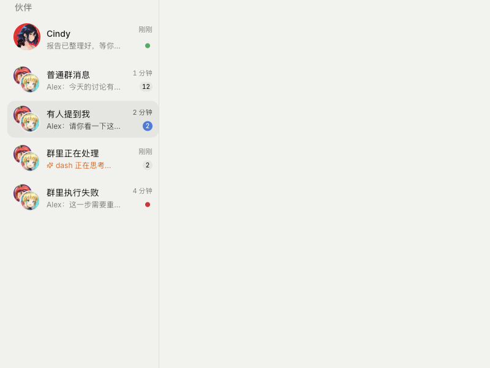
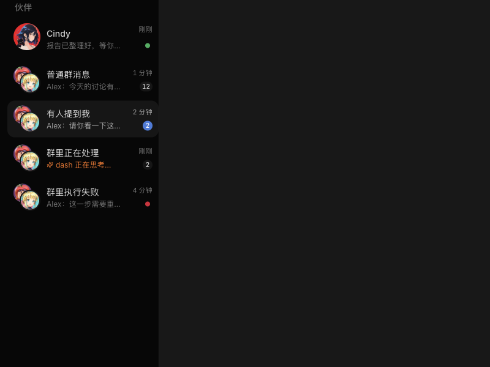
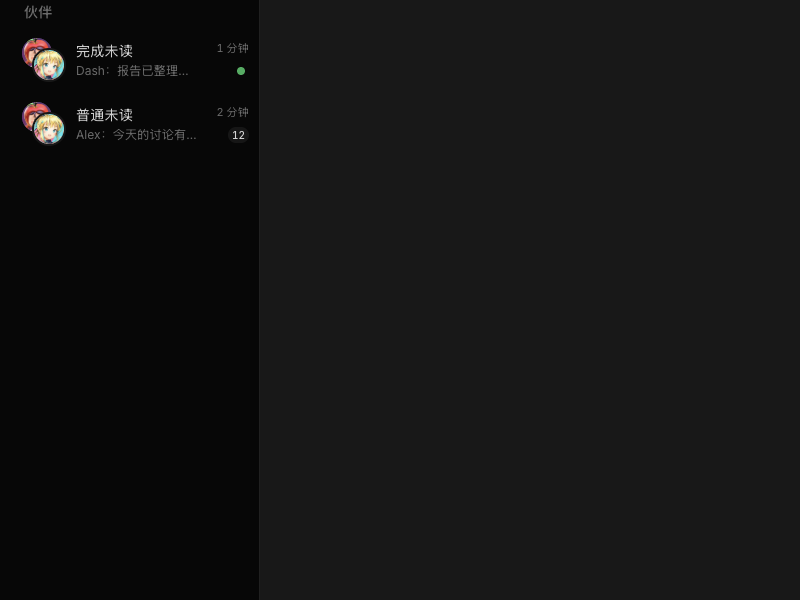

# #8714 精选验收图册

源码：`c520170db82006df33402750489503b8cb02a01a`。macOS / Electron 42.11.12 / Chromium 148.0.7778.280。真实生产组件、示例数据。仅精选 4 张静态图和 2 段真实录屏 GIF；未发布完整测试图库。GIF 每段约 6 秒、10fps，实时逐帧录制，非静态图合成动效。

[验收报告](REPORT.md) · [自包含 HTML 图册](gallery.html)

## 展开：普通未读、提及、执行与完成

## 展开：相同状态的深色效果

## 群完成未读与普通未读

## 收起：选中外描边、执行与未读提示

## 展开进行中：Bot 与群的呼吸效果

## 收起进行中：橙色状态点呼吸

