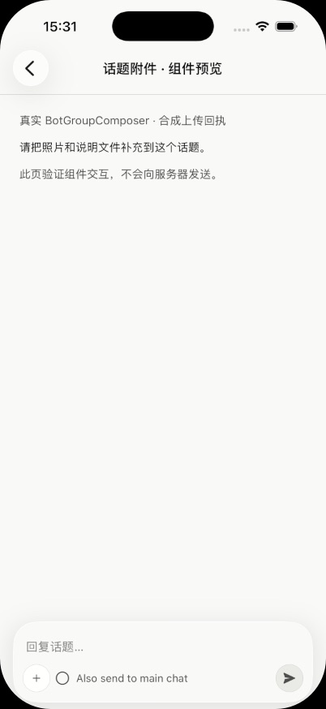
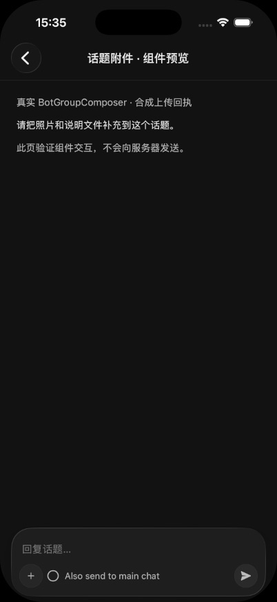
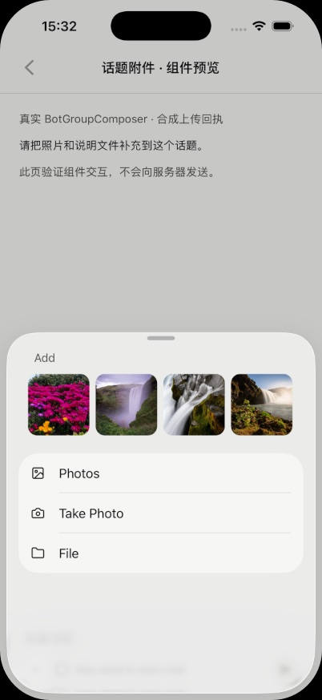
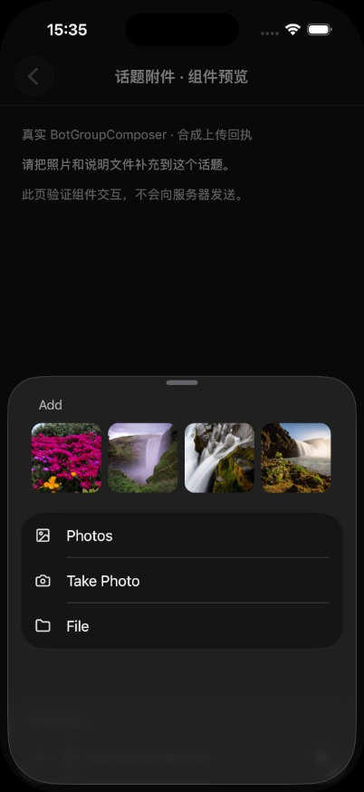
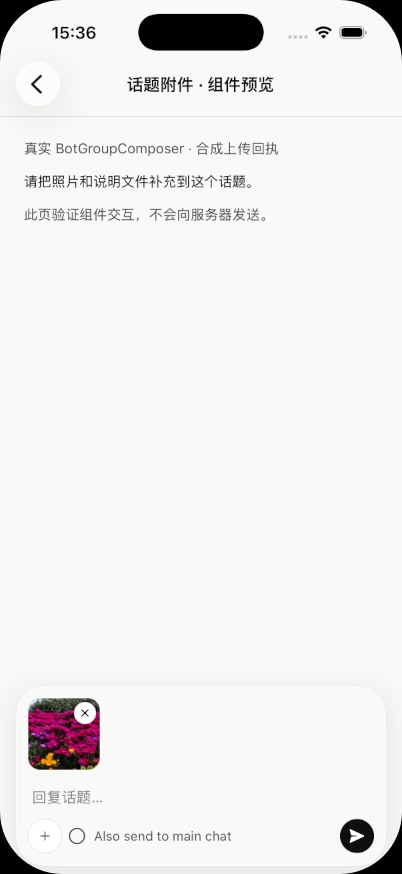
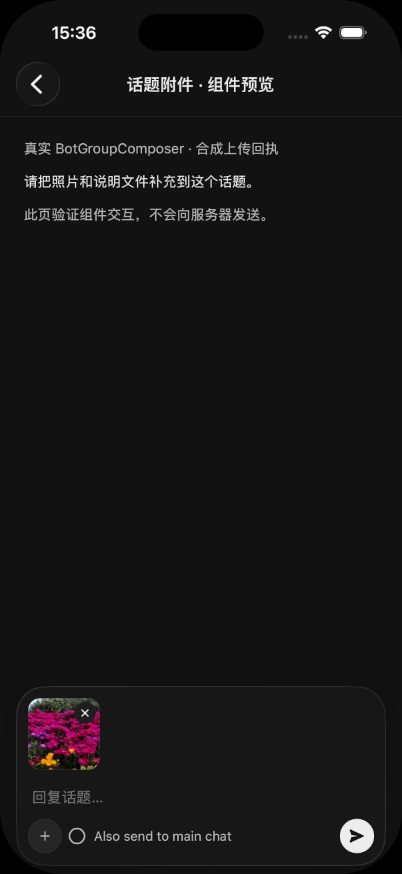

# 移动端话题附件交付报告

2026-11-06；实现提交 `ee4f732bc72668eb575996cf05e1301ee431c2ab`，分支 `cindy/zealous-curie`。
基于开发开始时 canonical main `9d62b213c960c63daa46996de8a606965f2f2299`。

## 问题与修复

主群已具备附件功能，手机话题仍显式关闭附件支持，且「同时发到群聊」替换了加号。
这次将加号与复选项并列，按实际能力开放附件；复用既有相册、拍照、文件、最近照片、粘贴、上传、托盘和重试路径。

- 仅附件和文字加附件均携带当前 threadRootId；同时发群沿用回复确认后再贴回主群的语义。
- 发送失败保留附件及 clientId；上传失败不发送残缺消息。切换话题不串发草稿/附件。
- 无附件能力时隐藏入口；不可交互时禁用。话题没有安排分工、代替会话状态入口，主群既有分工保留。
- 沿用页面卸载清理，不新增跨话题草稿保存。经电脑的旧群话题仍不支持。
- 没有修改服务端、device-link 白名单、协议、权限、原生依赖或上传状态机。

## 修改文件

- `apps/mobile/src/session/BotGroupChatScreen.tsx`：去除话题对附件能力的额外关闭。
- `apps/mobile/src/session/BotGroupComposer.tsx`：并列加号和同时发群，隐藏不支持的安排操作。
- `apps/mobile/src/__tests__/BotGroupChatScreen.test.tsx`：复用真实 screen/composer 的行为回归。
- `apps/mobile/src/__tests__/chatServerMobileEntry.test.tsx`：真实 hook、outbox、HTTP 序列化回归，网络/存储边界用替身。
- `docs/product-rules/bot-group-chat.md`：同步能力台账。

## 自动验证

先写回归：旧代码出现两项预期失败（话题缺少加号、仅附件不能发送），修复后通过。

```sh
pnpm --dir apps/mobile exec vitest run src/__tests__/BotGroupChatScreen.test.tsx src/__tests__/chatServerMobileEntry.test.tsx src/__tests__/useBotGroupChat.test.tsx src/__tests__/chatServerUpload.test.ts src/__tests__/useMobileLocalAttachmentsAbandon.test.tsx src/__tests__/BotGroupMessageAttachments.test.tsx
```

6 文件、331 项通过，8.95s。随后扩充话题附件重启重试，单独运行 `chatServerMobileEntry.test.tsx`：78 项通过、3.92s；最终覆盖 332 个不同用例。

测试价值：

- `BotGroupChatScreen.test.tsx`（unit）：既有主群用例不覆盖话题；最小失败输入是附件能力开启的根消息话题。验证加号/选择器、附件失败保留和话题切换隔离。发布前该文件最终 198 项独立运行 7.08s（collect 3.69s、tests 2.66s），主要耗时为既有大文件模块收集；未增加测试文件或逐例重载。
- `chatServerMobileEntry.test.tsx`（integration）：既有媒体用例只有主时间线；最小输入为空正文+媒体+threadRootId。检验最终 POST 及响应丢失后重启的精确重试，最终独立运行 3.92s。

其余通过项：

| 命令 | 结果 |
| --- | --- |
| `pnpm --dir apps/mobile typecheck` | 通过，预览临时路由删除后再验证 |
| `pnpm --dir apps/mobile test:scope` | 通过 |
| `pnpm check:test-hygiene` | 通过 |
| `pnpm check:design-colors --worktree` | 无新增非预期颜色；存在既有 Desktop 豁免过期提示 |
| mobile Vitest：designTokenDiscipline / textColorDiscipline / typographyTokenDiscipline / themeTokens | 37 项通过，0.852s |
| `pnpm check:dev-docs` | 10 项通过 |
| `git diff --check`、`pnpm check:dco` | 通过 |

同环境基线/改动的 `ci-fingerprint.mjs compute`、`compare` 结果一致：

- iOS：`44a2c23a6921fed96b400a1fba8975b6a86bb990`
- Android：`5cb0d36244aaea52d7cc2a415385cadcdf451031`

最早和结束时的跨环境计算不能直接比较；已保持依赖/本地环境一致重新核实。没有冷更输入改动，发布最终判定仍以发布流程为准。

**本地全量门禁未执行，等待 PR CI。** 本报告不宣称 CI 或自动评审已经通过。

## iOS 原生组件证据

这些是 **iOS 模拟器运行真实 BotGroupComposer 的组件 fixture**，上传与发送回执为合成数据；不代表真实服务器端到端发送。截图无真实账号、个人设备名称或私聊内容。

- 平台：iPhone 17 Pro，iOS 26.5，402×874。
- 工作区：宿主为 `cindy/zealous-curie` 分配的独立 worktree；本机绝对路径保留在本地交付报告。
- 启动：仓库 `mobile:sim:start -- --mock --port 8082` / `mobile:sim:up -- --mock --udid <隔离设备> --port 8082`。
- Metro 8082 属于本任务；既有其他任务的 8081 与设备未被接管。
- 身份回执：source/expectedSource `cindy/zealous-curie@9d62b213c+60dc42e953`，healthy=true、currentSourceOnExpectedPort=true、native-matched。页面另经深链与截图确认；whoami 的 pageVerified=false 不作为页面验收证据。
- 原生包：0.1.0 / build 2026072301，命中已验证构建缓存；没有新跑 xcodebuild。开发包指纹 `e11e6907d63ffe95415defbf246b40fdb8a1677b` 不与 CI production 指纹混比。
- 已实看深浅色加号/复选项、附件面板、最近照片选取、托盘、图片预览；仅图片+alsoSendToMain 的合成回调成功后清空托盘。
- 选择照片后关闭键盘再截图；fixture 未搭建完整 screen 的键盘避让，因此完整页面键盘遮挡未验证。
- 最初 fixture 重复合成 ID 的提示已修正并重新加载验证；不属于正式代码。完整 App Web 预览遇到原生初始化错误，未用作通过证据。
- 临时预览路由已删除；本任务 Metro 已停止、隔离设备已关机。截图采用运行时已有英文译文，未新增 UI 文案。

| 浅色 | 深色 |
| --- | --- |
|  |  |
|  |  |
|  |  |

[图片全屏预览](06-dark-photo-preview.jpg)

## 未验证与风险

- 真实服务端上传、发送、同时发群的两阶段网络流程、真实断网重连没有验收；自动测试只证明客户端请求体、发件箱及重试行为。
- 完整群聊界面的跨真实群/话题切换，真机拍照、原生文件选择完成上传、原生粘贴、慢网状态未逐项运行验收。
- Android、320px 小屏和大字号未实看；没有新增布局尺寸、颜色或样式。
- 合并前按既有 CI/评审门禁检查，并用真实可用账号补齐端到端验收。回滚本次实现提交即可恢复原入口行为，无数据 migration。

本报告与图片存放于作者 fork 的证据分支，不增加上游产品源码或原生包体积。
